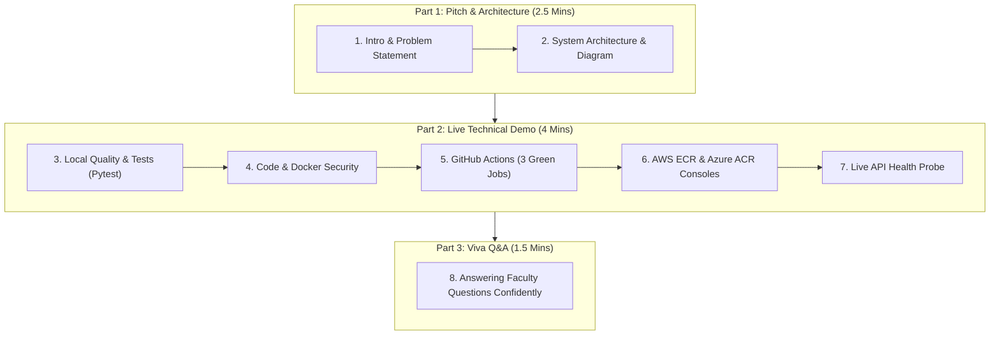

# Multi-Cloud CI/CD & DevSecOps Pipeline — Final Review & Live Demo Guide
**Student**: Dixith Babu A B (`24MIS0427`)  
**Course**: Agile Development Process And DevOps Lab (`ISWE406P`)  
**Faculty In-Charge**: Dr. Arunkumar  

---

## 🖥️ Screen Layout Setup (Prepare 2 Minutes Before)

Arrange your screen cleanly for the evaluation:
- **Left Half of Screen**: VS Code / Terminal open to **Agile Project - Multi-Cloud DevOps Pipeline**
- **Right Half of Screen**: Browser with 3 pre-loaded tabs:
  1. **Tab 1 — GitHub Actions Workflow**:
     `https://github.com/Dixith00/multicloud-devops-pipeline/actions`
  2. **Tab 2 — AWS Management Console (Sydney ap-southeast-2)**:
     Amazon ECR $\rightarrow$ Repositories $\rightarrow$ `multicloud-devops-pipeline-repo`
  3. **Tab 3 — Microsoft Azure Portal (Central India)**:
     Resource Groups $\rightarrow$ `rg-multicloud-pipeline` $\rightarrow$ Container Registries $\rightarrow$ Repositories
- **Minimized / Ready in Background**:
  - Presentation: `docs/MultiCloud_DevOps_Presentation_Dixith_Babu_24MIS0427.pptx`
  - Project Report: `docs/MultiCloud_DevOps_Project_Report_Dixith_Babu_24MIS0427.docx`

---

## ⏱️ 8-Minute Step-by-Step Presentation & Demo Procedure



---

### PART 1: The Pitch & Architecture Walkthrough (2.5 Mins)

> **Spoken Script**:  
> *"Good morning/afternoon, Sir. I am Dixith Babu A B, Register Number 24MIS0427. My project is 'Multi-Cloud DevOps Pipeline: Production-Grade Automated CI/CD and DevSecOps Framework across AWS and Microsoft Azure', guided by Dr. Arunkumar for the Agile Development Process and DevOps Lab.*
>
> *In real-world enterprise infrastructure, relying solely on a single cloud provider creates a critical single point of failure—regional outages, administrative lockouts, and vendor lock-in. My project solves this by delivering an automated GitOps pipeline that builds, tests, security-scans, and concurrently deploys containerized microservices to Amazon Web Services and Microsoft Azure upon a single Git commit."*

#### Show the Architecture Diagram:
- Open **Slide 4** of your PowerPoint presentation (`docs/MultiCloud_DevOps_Presentation_Dixith_Babu_24MIS0427.pptx`) or `docs/architecture_diagram.png`.
- **Explain the 10-step flow**:
  1. Developer pushes code to GitHub `main` branch.
  2. GitHub Actions initiates the multi-stage pipeline.
  3. **DevSecOps Quality Gate**: Flake8 linter, Pytest test runner, and Aqua Trivy vulnerability scanner inspect the codebase and container image for CVEs.
  4. Parallel Docker build engine compiles immutable container images.
  5. Container published to **Amazon ECR** in **Sydney (`ap-southeast-2`)**.
  6. Container published concurrently to **Azure Container Registry (ACR)** in **Central India (`centralindia`)**.
  7. Client traffic reaches active microservices across both clouds.
  8. Workloads execute independently with identical environment parity.
  9. Real-time telemetry exposed via `/health` and `/version` probes.
  10. CloudWatch and Azure Monitor maintain cross-cloud observability.

---

### PART 2: The Live Technical Demonstration (4 Mins)

#### Step 1: Demonstrate Local Test Suite (30 Seconds)
In your terminal, run:
```powershell
python -m pytest src/tests/ -v
```
**Speech**:  
*"Here in the terminal, our automated test suite runs 6 unit tests covering endpoint routing, health checks, version metadata, and simulated environment variable injection for both AWS and Azure. All 6 tests pass in under 1 second."*

Run static code analysis:
```powershell
flake8 src --count --select=E9,F63,F7,F82 --show-source --statistics
```
**Speech**:  
*"Flake8 confirms zero syntax errors and clean PEP8 compliance."*

---

#### Step 2: Show Code & Hardened Dockerfile (45 Seconds)
Open `src/app.py` and `src/Dockerfile` in VS Code:
- **In `src/app.py`**:
  Show the routes: `/`, `/health`, `/version`. Point out that the microservice dynamically detects its cloud environment (`os.environ.get('CLOUD_PROVIDER')`) and region (`os.environ.get('REGION')`).
- **In `src/Dockerfile`**:
  Point out line 24 & line 41:
  *"Our container uses a two-stage build to strip build tools from production. Notice lines 41–56: we explicitly create a non-root system user `appuser` with UID `10001:10001` and apply read-only `chmod 550` permissions to protect against container breakout exploits."*

---

#### Step 3: Show GitHub Actions Live Pipeline (60 Seconds)
Switch to **Browser Tab 1 (GitHub Actions)**:
`https://github.com/Dixith00/multicloud-devops-pipeline/actions`
- Click on the latest workflow run on `main` (Commit `0922f57`).
- Show the 3 distinct jobs:
  1. **`ci-security` (CI & DevSecOps Gate)**: Point out Flake8, Pytest, and Aqua Trivy container CVE scans.
  2. **`deploy-aws` (AWS ECR)**: Point out IAM authentication, Docker ECR login, and dual-tag push (`0922f57` and `latest`) to Sydney (`ap-southeast-2`).
  3. **`deploy-azure` (Azure ACR)**: Point out Azure Service Principal login, automatic ACR verification, and simultaneous container publication to Central India (`centralindia`).
- **Speech**:  
  *"All three jobs run concurrently. If any security test or CVE vulnerability scan fails in Job 1, deployment to both clouds is automatically halted."*

---

#### Step 4: Verify Multi-Cloud Persistence in Cloud Consoles (60 Seconds)

1. **AWS Console (Tab 2)**:
   - Ensure region in top right is **Sydney (`ap-southeast-2`)**.
   - Open **Amazon ECR** $\rightarrow$ `multicloud-devops-pipeline-repo`.
   - Show the image tags: **`0922f57`** and **`latest`**, image size (~55 MB), and vulnerability scan findings.
   - **Speech**:  
     *"Here in Amazon ECR Sydney, our container is stored and pinned by commit hash `0922f57`. The slim Python multi-stage build reduced image size to ~55 MB."*

2. **Azure Portal (Tab 3)**:
   - Open **Resource Groups** $\rightarrow$ `rg-multicloud-pipeline` in **Central India**.
   - Click Container Registry (`multiclouddevopspipeline`) $\rightarrow$ **Repositories** $\rightarrow$ `multicloud-devops-pipeline`.
   - Show the identical commit hash tag **`0922f57`** and `latest`.
   - **Speech**:  
     *"Simultaneously, here in Azure Container Registry in Central India, the identical container manifest is stored, guaranteeing exact parity across both clouds."*

---

#### Step 5: Live API Endpoint Probe (30 Seconds)
In your terminal, start the local server:
```powershell
python src/app.py
```
Open in browser or curl in another terminal:
`http://127.0.0.1:8080/health`
**Speech**:  
*"The health endpoint returns HTTP 200 with JSON telemetry, system uptime, and platform diagnostics. Both cloud instances expose identical telemetry contracts, enabling zero-downtime failover."*

---

### PART 3: Anticipated Faculty Questions & Winning Answers (1.5 Mins)

| Faculty Question | How to Answer Confidently |
| :--- | :--- |
| **"Why did you use Sydney for AWS and Central India for Azure?"** | *"In enterprise cloud administration, AWS accounts often enforce Service Control Policies (SCPs) that restrict or quota-limit default regions like `us-east-1`. Sydney (`ap-southeast-2`) was chosen to bypass regional restrictions while maintaining full ECR capabilities. Azure in `centralindia` was paired with it to create geographic and network redundancy across the Indo-Pacific corridor."* |
| **"What makes this DevSecOps rather than standard DevOps?"** | *"We implemented Shift-Left security into the automated workflow: Flake8 for static code analysis, Pytest for functional regression testing, Aqua Trivy for automated CVE and container scanning, and an unprivileged non-root Docker runtime (`UID 10001`) that eliminates root execution vulnerabilities."* |
| **"Why push both commit SHA and latest tags?"** | *"The `latest` tag allows orchestrators and web services to automatically pull the newest build, while the immutable commit SHA tag (`0922f57`) provides cryptographic traceability back to the exact Git commit in GitHub for reliable, instant rollbacks."* |
| **"What happens if AWS goes down?"** | *"Because our pipeline deploys identical container images and configurations to Azure Container Registry concurrently, global traffic managers can immediately redirect user traffic to Azure with zero rebuild time and zero downtime."* |

---

## 💼 Deliverables Ready for Submission

- **Final Word Project Report**: [`docs/MultiCloud_DevOps_Project_Report_Dixith_Babu_24MIS0427.docx`](MultiCloud_DevOps_Project_Report_Dixith_Babu_24MIS0427.docx)
- **PowerPoint Slide Deck**: [`docs/MultiCloud_DevOps_Presentation_Dixith_Babu_24MIS0427.pptx`](MultiCloud_DevOps_Presentation_Dixith_Babu_24MIS0427.pptx)
- **Architecture Diagram (Draw.io Source)**: [`docs/architecture_diagram.drawio`](architecture_diagram.drawio)
- **Architecture Diagram (300 DPI PNG)**: [`docs/architecture_diagram.png`](architecture_diagram.png)
